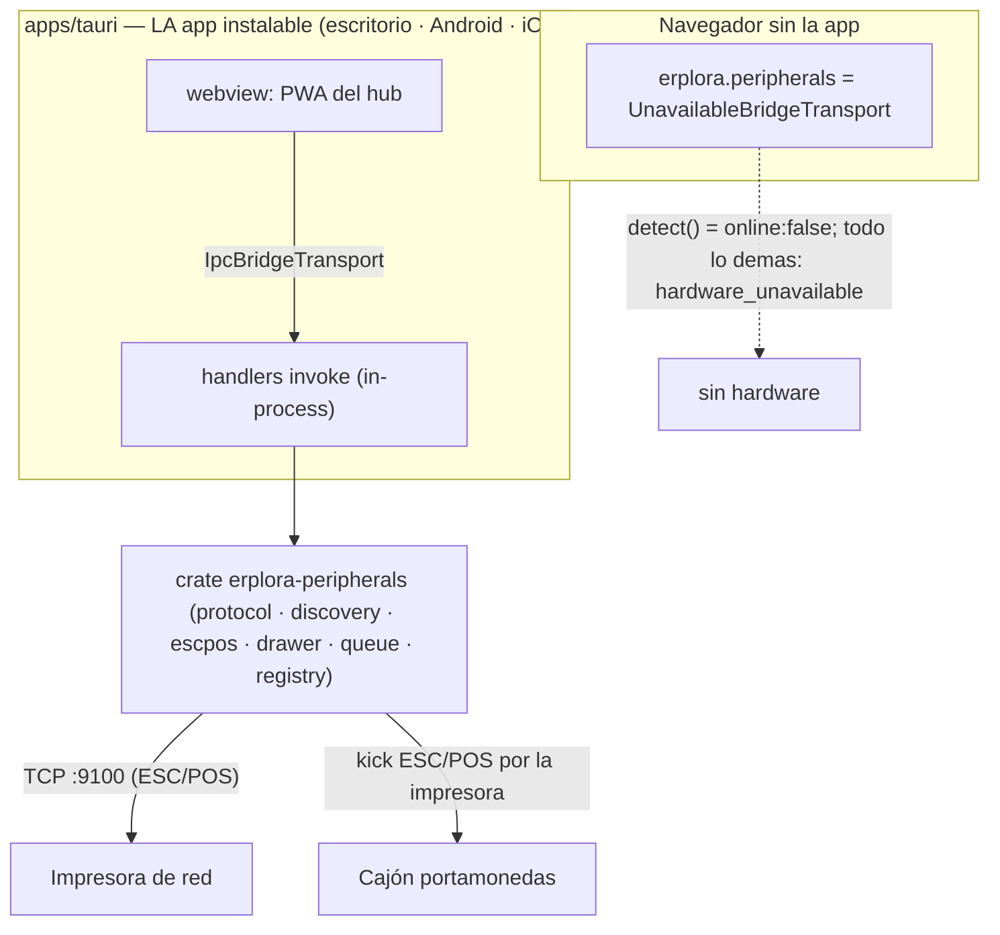

> Copia histórica de `erplora-old/architecture/bridge/README.md` @ `2113309c11a7201c8f61700d13008ba55f61db26`, 2026-10-14.
> Describe el producto antiguo; la referencia vigente es `erplora-next/PLAN*.md`.
> Índice, criterio de la copia y lo que no se copió: [`docs/legacy/README.md`](../README.md).

> Cargar este doc antes de editar cualquier parte del hardware (crate `peripherals` o su uso desde
> el shell Tauri).
>
> 🪦 **Solo queda UNA encarnación** (ADR-0196, ejecutado en hub#339 + hub#340 el 2026-08-08): el
> crate `hub/crates/peripherals` llamado **in-process** por la app instalable `hub/apps/tauri`.
> El standalone `hub/apps/bridge` (Axum, WS `:12321`) **se borró del árbol** y con él el pairing
> device-code y sus credenciales de máquina. **Ya no existe ningún WebSocket local de hardware**:
> lo que este doc y sus hermanos describen del canal `:12321` es HISTORIA.

El **Bridge** es el puente local de hardware POS de ERPlora: conecta el Hub (POS web/Tauri) con
periféricos físicos del local — impresoras térmicas y cajón portamonedas — hablando **ESC/POS sobre
red**. Es **red-only por decisión de arquitectura** ([hub/apps/bridge.md](../hub/apps/bridge.md), reubicado desde `hub/ARQUITECTURA.md §2.7`):
USB y Bluetooth se descartan en la línea Rust porque drivers + mantenimiento por SO no escalan, y el
escáner de códigos por HID lo gestiona el SO/navegador como teclado. **El Bluetooth SPP se retira**
([ADR-0180](../adr/ADR-0180.md), 2026-08-01): era la única ventaja real de la app
Kotlin, y con Android pasando a la misma app Tauri desaparece. `printer_id` es
`network:{ip}:{port}` en TODAS las plataformas. Este índice resume las piezas y enlaza
los docs hermanos; el detalle de diseño canónico vive en [`../hub/apps/bridge.md`](../hub/apps/bridge.md).

---

## Docs de esta sección

| Doc | Qué cubre |
|-----|-----------|
| [hardware-protocol.md](hardware-protocol.md) | ESC/POS, render de documentos, impresoras de red (TCP 9100), cajón (kick pin 2/5) |
| [websocket-interface.md](websocket-interface.md) | 🪦 HISTORIA — contrato JSON sobre el WS local (puerto 12321) del bridge standalone, borrado en hub#340. El **vocabulario** (comandos, `printer_id`, tipos de documento) sobrevive en `protocol.rs` y en los `invoke` del shell |
| [android-app.md](android-app.md) | 🪦 HISTORIA — app Android Kotlin (Ktor + servicio foreground). Android es la misma app Tauri (ADR-0180) |

Docs hermanos relevantes:
[../hub/apps/](../hub/apps/) (apps del Hub: `apps/tauri` y `apps/web`),
[../hub/crates/](../hub/crates/) (crates Rust), [../00-overview/decision-log.md](../00-overview/decision-log.md).

---

## Las dos encarnaciones del Bridge

Toda la lógica de hardware vive en **un crate Rust reutilizable** (`erplora-peripherals`), sin
servidor ni UI propios. Modelo DECIDIDO ([ADR-0050](../adr/ADR-0050.md)): **todas las
encarnaciones usan el mismo canal localhost (HTTP/WS)**; en Tauri el shell **arranca el bridge
embebido** (servidor localhost, reusando `crates/peripherals`), **no** handlers `invoke`:

| Encarnación | Stack | Transporte | Producto de despliegue | Estado |
|-------------|-------|-----------|---------------------|--------|
| `hub/apps/tauri` (el shell ES el bridge) | Rust + Tauri | **`invoke` in-process** — no hay servidor localhost ni WS | app instalable: Windows, macOS, Linux y **Android** | funcional (12 handlers) |
| 🪦 `hub/apps/bridge` (standalone) | Rust + Axum | `GET /status` + `WS /ws` (12321) | — | **BORRADO** (hub#340, 2026-08-08) |
| 🪦 `bridge/ERPlora-Bridge-android` | Kotlin + Ktor | `GET /status` + `WS /ws` (12321) | — | sin razón de existir (ADR-0180) |

> El precio explícito de retirar el standalone (ADR-0196): **una PWA en un navegador, sin la app
> instalada, no imprime tiques térmicos**. Es una decisión, no una regresión — encolar desde la PWA
> contra la cola del Hub es hub#344.

> ⚠️ La tabla decía que el shell Tauri arranca un **bridge embebido HTTP/WS** ([ADR-0050](../adr/ADR-0050.md))
> y que estaba «pendiente». Ninguna de las dos cosas es cierta desde
> [ADR-0159](../adr/ADR-0159.md): el shell expone el hardware por **`invoke`
> in-process**, sin servidor localhost, y está funcionando.

El **vocabulario** del protocolo sobrevive a la retirada: la fuente única sigue siendo
`hub/crates/peripherals/src/protocol.rs`, que hoy consumen los `invoke` del shell en vez de las
frames WS.

> Nota de origen: la línea Rust **reemplaza** al antiguo Bridge Python (`ERPlora-Bridge-desktop`).
> Cada módulo del crate documenta su mapeo Python→Rust. Detalle de diseño en
> [`../hub/apps/bridge.md`](../hub/apps/bridge.md) (reubicado desde `hub/ARQUITECTURA.md §2.7`) y el crate
> [`../hub/crates/peripherals.md`](../hub/crates/peripherals.md).

---

## Crate `erplora-peripherals` — módulos

Fuente: `hub/crates/peripherals/src/`.

| Módulo | Responsabilidad |
|--------|-----------------|
| `protocol` | Tipos `serde` `Command`/`Event`/`PrinterInfo`/`Device` — contrato JSON Hub↔Bridge |
| `discovery` | `parse_printer_id`, escaneo de subred /24 al 9100, mDNS, enriquecido con MAC |
| `escpos` | Render ESC/POS: `document_type` + `data` JSON → bytes (receipt, kitchen, invoice, etc.) |
| `drawer` | Apertura de cajón vía kick ESC/POS por el socket de la impresora |
| `queue` | Cola de impresión + reintentos/backoff (impresora apagada / sin papel) |
| `registry` | Registro persistente `devices.json` (MAC→dispositivo), resolución ARP, watchdog DHCP |

Constantes clave (`lib.rs`): `ESCPOS_NETWORK_PORT = 9100`, `BRIDGE_WS_PORT = 12321`.

---

## Diagrama de componentes

Un solo camino al hardware, y **sin puerto local**. Lo que había antes —`apps/bridge` y la app
Kotlin sirviendo `GET /status` + `WS /ws` en `:12321`, con `hub/static/js/bridge.js` como cliente—
se retiró con ADR-0196 (hub#339 + hub#340). Ver [`../hub/apps/bridge.md`](../hub/apps/bridge.md).
