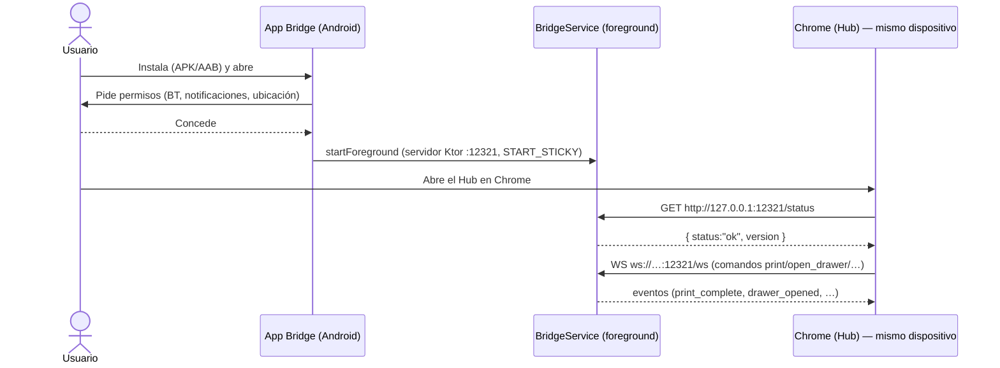

> Copia histórica de `erplora-old/architecture/bridge/android-app.md` @ `2113309c11a7201c8f61700d13008ba55f61db26`, 2026-10-14.
> Describe el producto antiguo; la referencia vigente es `erplora-next/PLAN*.md`.
> Índice, criterio de la copia y lo que no se copió: [`docs/legacy/README.md`](../README.md).

> 🪦 **HISTORIA — esta app ya no existe y no se edita.** ADR-0196 la mató y hub#340 la ejecutó
> (2026-08-08): no hay app Kotlin, ni servidor embebido, ni servicio foreground, ni la carpeta
> `bridge/ERPlora-Bridge-android/` que este doc dice cargar — **el directorio `bridge/` del
> workspace no existe**. Android es hoy **la misma app Tauri** que escritorio (ADR-0180,
> `com.erplora.app`), y el **Bluetooth SPP** —lo único que esta app aportaba de verdad— volvió en
> [ADR-0204](../adr/ADR-0204.md) dentro del plugin propio
> `hub/crates/tauri-plugin-erplora-android`. Fuente viva:
> [`../hub/apps/tauri.md`](../hub/apps/tauri.md).
>
> El repo `ERPlora-Bridge-android` de GitHub sigue **sin archivar**: es pm#52, aún abierta.
> Lee esto solo para entender de dónde viene el SPP; **no** para diseñar nada.

Este doc describe la **app Android (Kotlin)** del Bridge: una app ligera que corre un servidor
embebido y mantiene vivo el puente de hardware como **servicio foreground** mientras el usuario usa el
Hub en Chrome **en el mismo dispositivo**. Habla el mismo contrato WS que la línea Rust
([websocket-interface.md](websocket-interface.md)) y renderiza los mismos documentos ESC/POS
([hardware-protocol.md](hardware-protocol.md)), pero **añade Bluetooth SPP** por capacidad nativa de
Android. Todo lo aquí descrito está fundamentado en el código de `bridge/ERPlora-Bridge-android/`.

---

## Por qué una app separada (no el crate Rust)

A diferencia del standalone Rust (`apps/bridge`) y el sidecar Tauri, la app Android **reimplementa el
protocolo en Kotlin** (`protocol/Protocol.kt` es el espejo de `protocol.rs`). Razones de plataforma:

- Acceso nativo a **Bluetooth RFCOMM/SPP** (impresoras BT emparejadas) que la línea Rust descarta.
- Modelo de **servicio foreground** de Android para sobrevivir a la gestión agresiva de procesos en
  background mientras el POS corre en el navegador.

Ambas implementaciones **DEBEN** producir JSON idéntico para que `hub/static/js/bridge.js` funcione
con cualquiera; al añadir un comando o documento hay que actualizar las dos.

---

## Stack

| Pieza | Valor |
|-------|-------|
| Lenguaje | Kotlin 2.1.0 |
| Servidor | Ktor 3.0.3 (motor Netty embebido) |
| JSON | `kotlinx.serialization.json` 1.7.3 (sin concatenación de strings) |
| Coroutines | `kotlinx-coroutines-android` 1.9.0 |
| `compileSdk` / `targetSdk` | 36 (Android 16) |
| `minSdk` | 26 (Android 8.0 Oreo) |
| Versión | `versionCode 3`, `versionName "0.3.0"` |
| Java | 17 (source + target) |
| Release | ProGuard `isMinifyEnabled = true`; firma con `app/erplora-bridge.keystore` (alias `erplora`) |

Build: `./gradlew assembleRelease` (APK) / `bundleRelease` (AAB), `-PKEYSTORE_PASSWORD=…`. CI
(`.github/workflows/build.yml`) firma y sube a `s3://erplora-saas/downloads/bridge/{latest,vX.Y.Z}/`
(Hetzner Object Storage, privado + presign — ADR-0099; antes `erplora-downloads`, borrado
2026-07-01) (`.apk` directo + `.aab` Google Play).

---

## Estructura del proyecto

`app/src/main/java/com/erplora/bridge/` organizado en capas:

| Paquete | Fichero | Responsabilidad |
|---------|---------|-----------------|
| `protocol/` | `Protocol.kt` | Contrato WS (comandos/eventos) en JSON — espejo de `protocol.rs`; `PrinterInfo`, `parseMessage`, `generateJobId` |
| `server/` | `BridgeServer.kt` | Servidor Ktor: `GET /status` + `WS /ws`, ruteo de comandos, broadcast, arranque del watchdog |
| `hardware/` | `PrinterDiscovery.kt` | Descubrimiento red (/24 al 9100, 300ms) + Bluetooth (`bondedDevices` filtrados por clase 0x600 / nombre) |
| `hardware/` | `PrinterConnection.kt` | Interfaz `raw/text/set/cut/close` + `NetworkPrinter` (TCP 9100) y `BluetoothPrinter` (RFCOMM SPP, UUID `00001101-…`) |
| `hardware/` | `PrinterManager.kt` | Renderizadores de documento ESC/POS (receipt, kitchen, invoice→receipt, delivery, barcode, cash, generic) + cache de impresoras |
| `hardware/` | `CashDrawer.kt` | Kick ESC/POS pin 2/5 por la impresora |
| `hardware/` | `DeviceRegistry.kt` | Registro persistente MAC→dispositivo |
| `hardware/` | `DeviceWatchdog.kt` | Health-check periódico + recovery scan por MAC (callbacks `onDeviceRecovered`/`onDeviceLost`) |
| `service/` | `BridgeService.kt` | Servicio foreground (`START_STICKY`), canal de notificación `erplora_bridge` |
| `ui/` | `MainActivity.kt` | Solicita permisos y lanza el servicio (UI mínima) |

`BridgeServer` (puerto 12321, `host = "0.0.0.0"`) instala plugins `WebSockets`,
`ContentNegotiation(json)` y `CORS(anyHost, GET/POST)`. Mantiene un set sincronizado de conexiones,
hace `broadcast` a todas (limpiando las muertas) para eventos del watchdog, y ejecuta la I/O de
hardware en `Dispatchers.IO`.

---

## Servicio foreground y permisos

`BridgeService` arranca con `startForeground` + notificación persistente ("ERPlora Bridge — Running on
port {port}") y devuelve `START_STICKY` (se reinicia si lo matan). Declarado en el manifest con
`foregroundServiceType="connectedDevice"` (requerido para Bluetooth en Android 14+).

Permisos (manifest + solicitados en `MainActivity`):

| Permiso | Desde | Para |
|---------|-------|------|
| `INTERNET`, `ACCESS_NETWORK_STATE` | siempre | Servidor + escaneo de red |
| `BLUETOOTH` / `BLUETOOTH_ADMIN` | legacy | Bluetooth clásico |
| `BLUETOOTH_CONNECT` / `BLUETOOTH_SCAN` | API 31+ | Conectar/escanear impresoras BT |
| `ACCESS_FINE_LOCATION` | siempre | Requerido por el escaneo Bluetooth |
| `FOREGROUND_SERVICE` (+ `_CONNECTED_DEVICE`) | — | Servicio foreground con acceso a dispositivos |
| `POST_NOTIFICATIONS` | API 33+ | Notificación del servicio |

---

## Divergencias con la línea Rust (conocidas)

- Android **conserva** Bluetooth SPP, los comandos/eventos `toggle_keyboard` / `keyboard_toggled` y el
  evento `barcode` (todavía en `ACTIONS` de `Protocol.kt`), que la línea Rust elimina por la decisión
  red-only (ver [websocket-interface.md](websocket-interface.md)).
- `printer_id` admite `network:{ip}:{port}` y `bluetooth:{address}`.
- Texto en `ISO-8859-1` (Android) vs CP437 (Rust) — ambas aproximan el set Europa Occidental.
- Cuerpo de `GET /status`: el **contrato mínimo común** es `{ "ok": true, "version" }` (lo único
  que consume `bridge-client.ts`); el resto de claves son informativas por plataforma. Android
  todavía **no emite `ok`** (solo `status:"ok"`), por lo que `detectBridge()` lo reporta offline —
  pendiente en el repo Android. Checklist de paridad completa en
  [websocket-interface.md](websocket-interface.md).
- La doc histórica del repo Android menciona `toggle_keyboard` y la app Desktop Python como par; la
  línea de verdad actual es la Rust (`hub/crates/peripherals`). El README del repo Android tiene
  ejemplos de payload útiles pero **algunos detalles (USB Desktop, rutas `native/android/`) son del
  estado anterior** — pendiente de verificar contra el código vigente.

---

## Flujo de uso

