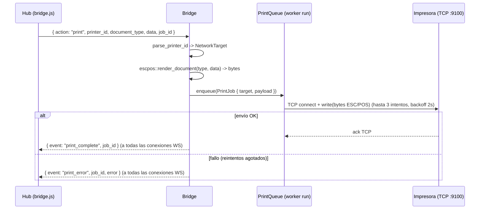

> Copia histórica de `erplora-old/architecture/bridge/hardware-protocol.md` @ `2113309c11a7201c8f61700d13008ba55f61db26`, 2026-10-14.
> Describe el producto antiguo; la referencia vigente es `erplora-next/PLAN*.md`.
> Índice, criterio de la copia y lo que no se copió: [`docs/legacy/README.md`](../README.md).

> Cargar este doc antes de editar el render ESC/POS, el descubrimiento de impresoras o el cajón (`hub/crates/peripherals/src/{escpos,discovery,drawer,queue,registry}.rs`).
>
> ✅ **Este doc SIGUE VIVO** — a diferencia de sus hermanos de esta carpeta. Lo que describe (ESC/POS
> sobre TCP, render de documentos, descubrimiento y cajón) es el crate `hub/crates/peripherals`, que
> existe y se usa. Lo único caducado es **quién lo llama**: ya no hay «Bridge» (ADR-0196, hub#340).
> Hoy lo invoca **in-process la app instalable** [`hub/apps/tauri`](../hub/apps/tauri.md), y los
> trabajos le llegan por la [cola de impresión del Hub](../hub/print-queue.md). Vive aquí por
> historia; su sitio natural es [`../hub/crates/peripherals.md`](../hub/crates/peripherals.md).

Este doc describe **cómo se habla con el hardware físico**: el protocolo ESC/POS sobre TCP,
los renderizadores de documento, el descubrimiento/registro de impresoras de red y el kick del cajón.
El vocabulario del contrato JSON (comandos, `printer_id`, tipos de documento, códigos de error)
sobrevive en los `invoke` in-process y su historia está en
[websocket-interface.md](websocket-interface.md). Todo lo aquí descrito está fundamentado en el
código del crate `erplora-peripherals`.

---

## Transporte físico: ESC/POS sobre TCP

- Las impresoras térmicas POS exponen **raw printing** en el puerto TCP **9100** (`ESCPOS_NETWORK_PORT`).
- Un `printer_id` es siempre `network:{ip}:{port}` (red-only). `parse_printer_id` separa el esquema por
  el primer `:` (rechaza `usb:`/`bluetooth:`) y el puerto por el último `:` (host puede contener `:`,
  p.ej. IPv6); sin puerto → 9100 por defecto (`discovery.rs`).
- Imprimir = abrir socket TCP al destino, escribir los bytes ESC/POS renderizados, cerrar
  (`queue::send_once`).
- El texto se codifica en **CP437** (`oem_cp`, lo no representable → `?`), espejo del
  `txt.encode('cp437', errors='replace')` del Bridge Python. La app Android usa `ISO-8859-1` como
  aproximación.

### Comandos ESC/POS crudos (constructor `EscposBuilder`)

| Operación | Bytes | Método |
|-----------|-------|--------|
| Alineación (izq/centro/der) | `ESC a n` (`1b 61 {0\|1\|2}`) | `set(align, …)` |
| Negrita on/off | `ESC E n` (`1b 45 {1\|0}`) | `set(…, bold, …)` |
| Doble alto / ancho | `GS ! n` (`1d 21`, `n\|0x10` alto, `n\|0x20` ancho) | `set(…, double_h, double_w)` |
| Corte de papel | `\n\n\n` + `GS V 1` (`1d 56 01`) | `cut()` |
| Código de barras **nativo** | `GS h/w/H/f` (altura/ancho/HRI) + `GS k` función B: EAN13 (m=67) si 12-13 dígitos, CODE128 set B (m=73, prefijo `{B`) en otro caso | `barcode(code)` |
| QR **nativo** | `GS ( k` modelo 2: fn 165 (modelo) → 167 (módulo) → 169 (corrección M) → 180 (datos) → 181 (imprimir) | `qr(data)` |

`LINE_WIDTH = 32` columnas (papel de 80mm ≈ 32 chars). `total_line(label, amount)` alinea el importe
a la derecha rellenando con espacios.

> Barcode y QR son **nativos** desde bridge#1 (antes `barcode` era un fallback de texto `[code]`).
> `barcode` conserva el fallback de texto solo para código vacío o > 250 bytes (límite de `GS k`);
> `qr` es no-op con datos vacíos o > ~7 KB. El QR se emite en `render_receipt` cuando el payload
> trae `qr_data` (p.ej. VeriFactu / enlace a factura); el barcode en `render_barcode_label`.

---

## Renderizadores de documento

`render_document(document_type, data)` despacha el JSON del Hub a un renderizador por tipo
(`escpos.rs`). Tipo desconocido → `Generic` (espejo del `else` de Python).

| `document_type` | Renderizador | Contenido |
|-----------------|--------------|-----------|
| `receipt` | `render_receipt` | Cabecera negocio (nombre/dir/NIF/tel), ticket+fecha+cajero+cliente, líneas de ítem (`{qty}x nombre … total`, notas), subtotal/IVA/descuento, TOTAL en doble tamaño, método de pago, entregado/cambio, header/footer, "Gracias por su compra" |
| `invoice` | (delega en `render_receipt`) | Idéntico al receipt |
| `kitchen_order` | `render_kitchen_order` | "COCINA" + `#order`, mesa/camarero/hora, ítems en doble alto/ancho con notas `>>`, "!! URGENTE !!" si `priority == "HIGH"` |
| `delivery_note` | `render_delivery_note` | "ALBARAN", nº/fecha/cliente/dirección, ítems, línea de firma |
| `barcode_label` | `render_barcode_label` | Nombre de producto, `[barcode]`, precio en doble tamaño |
| `cash_session_report` | `render_cash_report` | "CIERRE DE CAJA", sesión/fecha/cajero, apertura/cierre/diferencia, transacciones |
| (otro) | `render_generic` | Título + todas las claves del `data` como `clave: valor` |

### El idioma del papel viaja en el documento (hub#1159)

Las etiquetas de **todos** los renderizadores salen de un catálogo `(en, es)` que vive en
`escpos.rs`, y el idioma se lee del propio documento: `locale` del `data` (`Locale::from_document`,
que ignora la región — `es-ES` es `es`). El inglés es el idioma **fuente**, nunca el del papel
(ADR-0055/0199), y el **fallback es `es`**: un documento sin `locale` imprime el papel de siempre,
byte a byte, porque la flota de `erplora-app` no se actualiza tan rápido como un módulo. `locale`
es campo del **sobre**, no una línea: `render_generic` lo excluye a propósito.

### La hoja de prueba

`render_test_page(printer_id, data)` produce una página de prueba centrada (cabecera, resultado,
timestamp, printer id) y, **desde hub#1803, es papel como el resto**: lee del mismo sobre `data` que
cualquier otro documento sus dos campos —`locale` (el idioma, arriba) y `business_name` (la
cabecera, con el mismo fallback a `escpos::PRODUCT_NAME` que `render_receipt`)—.

Antes recibía solo un `printer_id`, así que era el único documento **sin sobre**: sus dos líneas
eran literales ingleses y la cabecera el nombre del producto, de modo que un hub en español sacaba
«Test Print OK» firmado «ERPlora» por la misma impresora que un segundo después imprimía el tique en
español y con el nombre del negocio. (Hasta hub#1735 la cabecera decía además "ERPlora Bridge", el
producto que ADR-0196 retiró.)

El sobre es **opcional** en la puerta (`erplora_test_print` toma `Option<Value>`): una app instalable
más nueva que el módulo que la llama imprime la hoja de fallback, nunca un error. Quien lo rellena es
la pantalla de Impresión del módulo `printing`, con el idioma del shell y la primera línea de
`receipt_header` —el contrato que ese ajuste ya tiene para el tique: primera línea el nombre, el
resto la dirección—.

Helpers de lectura del JSON replican la semántica "truthy" de Python
(`is_truthy`), el formateo de cantidad entero-vs-decimal (`fmt_qty`) y `True/False/None` para el
documento genérico.

---

## Cajón portamonedas (drawer)

El cajón se abre con un **kick ESC/POS enviado por el socket de la impresora** a la que está conectado
(`drawer.rs`).

| Pin | Bytes (`ESC p {pin} 25 50`) | Constante |
|-----|------------------------------|-----------|
| 2 (por defecto) | `1b 70 00 19 32` | `KICK_PIN_2` |
| 5 | `1b 70 01 19 32` | `KICK_PIN_5` |

`open_drawer(target, pin)`: abre TCP al `target`, escribe el kick (pin 2 → KICK_PIN_2; cualquier otro
→ KICK_PIN_5). El comando WS `open_drawer` trae `pin` con default 2.

---

## Cola de impresión y reintentos

`queue.rs` modela una cola explícita (no existía en el Bridge Python, donde imprimir era síncrono)
para no perder trabajos cuando la impresora no responde (apagada / sin papel).

- `PrintJob { job_id, target, payload (bytes ya renderizados), attempts }`.
- `RetryPolicy` por defecto: `max_attempts = 3`, `backoff_ms = 2000`.
- `process` reintenta hasta `max_attempts`; entre fallos espera `backoff_ms`; emite
  `JobOutcome::Completed` o `Failed`.
- `run(outcomes)` es el bucle worker: drena la cola y publica cada `JobOutcome` por el
  `UnboundedSender` que recibe (el consumidor lo mapea a `print_complete` / `print_error`).

> Cableado en el binario standalone (bridge#8): `main()` spawnea `PrintQueue::run` y los comandos
> `print`/`test_print` **encolan** (`enqueue`) en vez de enviar con un solo intento; el outcome
> llega de forma asíncrona por el bus de eventos a **todas** las conexiones WS abiertas
> (ver [websocket-interface.md](websocket-interface.md)). `send_once` queda como primitiva interna
> del worker.

---

## Descubrimiento y registro de impresoras

### Descubrimiento (`discovery.rs`)

`discover_printers(registry)` combina dos métodos y deduplica (mDNS gana ante colisión de IP):

| Método | Detalle |
|--------|---------|
| Escaneo de subred /24 | 254 sondas TCP concurrentes a `{prefix}.1..=254:9100`, timeout 300ms; subred detectada vía UDP "connect" a `8.8.8.8:80` sin enviar nada |
| mDNS/Bonjour | navega `_pdl-datastream._tcp.local.` e `_ipp._tcp.local.` durante 1500ms (daemon `mdns-sd` en hilo bloqueante); ante error → lista vacía |

Tras descubrir, cada impresora de red se enriquece con su MAC (ARP) y se registra.

### Registro persistente (`registry.rs`)

- `DeviceRegistry` respaldado por `devices.json` (mapa MAC→`Device`), `RwLock` síncrono + escritura a
  disco en cada mutación; carga tolerante a corrupción (mapa vacío).
- `Device { mac, ip, port, name, role?, kind, first_seen, last_seen, status }`. `register` preserva
  `first_seen` y `role` al re-ver una MAC.
- Roles asignables: `receipt | kitchen | bar | label` (`set_role`).
- MAC vía `get_mac_for_ip`: `ping` (poblar caché ARP) + `arp` (multiplataforma), `normalize_mac` a
  mayúsculas separadas por `:`.

### Watchdog de auto-recuperación DHCP

`Watchdog` en segundo plano (`registry.rs`):

| Parámetro | Default |
|-----------|---------|
| `check_interval_s` | 30 |
| `recovery_interval_s` | 120 |
| `connect_timeout_ms` | 1000 |

`check_devices` marca online/offline cada `check_interval`. `recovery_scan` (cada `recovery_interval`)
re-barre la subred buscando por MAC los dispositivos offline (la IP pudo cambiar por DHCP) y actualiza
su IP (`update_ip`). Los eventos `Recovered`/`Lost` se publican por un canal `mpsc` opcional
(builder `Watchdog::with_events(tx)`, además del log por `tracing`; sin canal el comportamiento es
solo-log). En el binario standalone (bridge#8) `main()` arranca el watchdog con la config por
defecto y puentea sus eventos al bus WS como `device_recovered`/`device_lost`.

> Limitación conocida (portada de Python): `recovery_scan` sondea las 254 IPs **secuencialmente**
> (timeout 1s cada una) y bloquea el bucle del watchdog hasta ~4 min; durante el barrido no corren
> `check_devices`. Paralelizarlo es una mejora pendiente, no un requisito de bridge#8.

---

## Flujo de un trabajo de impresión

