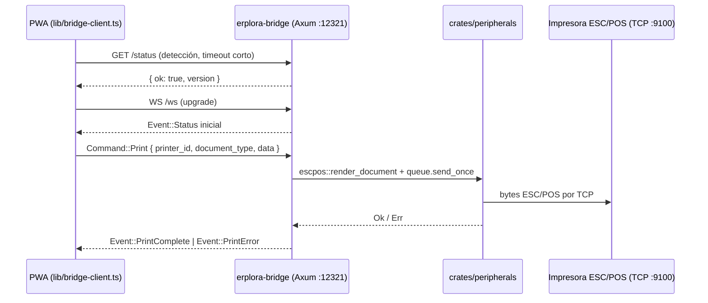

> Copia histórica de `erplora-old/architecture/hub/apps/bridge.md` @ `2113309c11a7201c8f61700d13008ba55f61db26`, 2026-10-14.
> Describe el producto antiguo; la referencia vigente es `erplora-next/PLAN*.md`.
> Índice, criterio de la copia y lo que no se copió: [`docs/legacy/README.md`](../../README.md).

# Hub · `apps/bridge` — Bridge de hardware standalone (Rust + Axum)

> 🪦 **ADR-0196 (2026-08-03) mata este componente.** Mueren `apps/bridge` (WS `:12321`), la app
> Kotlin, el pairing device-code y las credenciales `bridge_jwt` / `bridge_device_token`; en el SDK
> desaparece `WsBridgeTransport` y queda `isTauri()` → `invoke` in-process. La cola de impresión se
> muda al **Hub** — ya as-built, ver [`../print-queue.md`](../print-queue.md) (hub#341). Y [ADR-0204](../../adr/ADR-0204.md) (2026-08-06) añade el
> **SPP Bluetooth de Android** dentro del **plugin Tauri propio** (`tauri-plugin-erplora-android`),
> no aquí.
>
> **As-built (2026-08-08, hub#339): la mitad del SDK YA está retirada.** `WsBridgeTransport` (y su
> clase `BridgeClient`, y `BRIDGE_DEFAULT_PORT`) **no existen** en `packages/module-sdk`. Queda un
> solo transporte de hardware, `IpcBridgeTransport` sobre `invoke`, y con el WS se fueron sus tres
> problemas de navegador: PNA, el mixed-content de una página `https` abriendo `ws://localhost` y la
> clave pública con la que se verificaba offline el token de emparejamiento. En un navegador sin la
> app, `erplora.peripherals` es `UnavailableBridgeTransport`: `detect()` contesta `{online:false}`
> —no rechaza, porque el módulo `printing` lo llama sin `try/catch`— y toda operación de hardware
> rechaza con el código `hardware_unavailable`; **nunca resuelve callando**, que dejaría al TPV
> dando por impreso un tique que no ha salido. La frase que lee el usuario la pone el shell
> (`apps/web/src/lib/printer-discovery.ts → hardwareUnavailableMessage`), mismo reparto que en
> hub#338: el SDK pone el `code`, el shell pone las palabras.
>
> **As-built (2026-08-08, hub#340): la otra mitad TAMBIÉN está retirada. `hub/apps/bridge/` ya no
> existe.** Se fueron del árbol el binario entero (Axum `GET /status` + `WS /ws` en
> `localhost:12321`, ~3.100 líneas), el pairing device-code (`src/pairing.rs`), su verificación de
> JWT (`src/auth.rs`), el icono de bandeja, el manifest MSIX de la 2ª ficha y el workflow
> `bridge-release.yml` que publicaba `downloads/bridge/`. En el runtime desapareció el proxy
> `GET /api/bridge/token` y en `cloud-client` el método `bridge_token()`; en el shell web, el
> refresco cada 12 min (`startBridgeTokenRefresh`) que pedía una credencial que **nadie
> presentaba** desde hub#339.
>
> Antes de borrar se hizo el **barrido de consumidores** que exige el ADR, y salió limpio: 0 de 24
> módulos, 0 crates (el binario no era dependencia de nadie), 0 llamadores del proxy fuera del
> propio refresco. Y en **producción, 0 filas**: `BridgeDevice = 0`, `BridgePairing = 0` — no había
> ni un dispositivo emparejado al que dejar sin camino.
>
> **Lo que queda, y dónde:** los endpoints `api/v1/bridge/{pair/start,pair/poll,pair/redeem,token}/`
> y `device/bridge-token/` del SaaS, con sus modelos `BridgePairing`/`BridgeDevice` — ahora sin un
> solo llamador → **saas#1274**. Y el enlace de descarga del panel de Sistema, que aún apunta a
> `/bridge/download/` → **hub#507**.
>
> **No construyas nada nuevo sobre lo que describe este doc**: es HISTORIA. El modelo vigente es la
> app instalable (`invoke` in-process) + la cola de impresión en el Hub.

> 🪦 *HISTÓRICO — superado por ADR-0196/0204 (la app principal es la app Tauri única).*
> ⭐ **ADR-0154 (2026-07-25) — el Bridge es la APP PRINCIPAL de ERPlora.** Con la eliminación de la capa
> local (app Tauri + SQLite, hub#210 **mergeado**), el Bridge es lo único que el usuario instala:
> además de dar hardware a la PWA, hace el **onboarding «2 clics»** por device-code (RFC 8628). As-built:
> `src/pairing.rs` (cliente device-code, hub#205 **mergeado**) contra los endpoints `api/v1/bridge/` del
> SaaS (saas#815 **mergeado**), reutilizando `mint_bridge_token` (RS256 `aud="erplora-bridge"`) y el
> PNA/CORS ya resuelto. Descripción real en §[Pairing device-code](#pairing-device-code-adr-0154).
> Detalle en [ADR-0154](../../adr/ADR-0154.md).

> 🪦 *HISTÓRICO — superado por ADR-0196/0204 (mueren la app Kotlin, el bridge Ktor y la «vía
> secundaria» headless; el hardware va por `invoke` in-process en la app Tauri).*
> ⭐⭐ **[ADR-0159](../../adr/ADR-0159.md) (2026-07-26) — la app cliente pasa a ser el
> shell-webview; este binario headless queda para el caso navegador.** La app que el usuario instala
> renderiza el onboarding del SaaS y la PWA del hub en una **webview** (escritorio = shell Tauri fino,
> [`tauri.md`](tauri.md), hardware por `invoke` **sin** este bridge WS ni device-code; Android =
> `WebViewActivity` en la app Kotlin, cuyo bridge Ktor sigue sirviendo el hardware por WS `:12321`).
> **Este binario (`erplora-bridge`) y su pairing device-code SIGUEN VIVOS** como vía secundaria:
> «PWA en Chrome/instalada + bridge headless» (p. ej. equipo donde no se quiere la app). Estado 0159:
> **implementado y mergeado** (hub#225 · android#11 · saas#850, 2026-07-26).

> 🪦 *HISTÓRICO — superado por ADR-0196/0204: la ficha única `com.erplora.app` la ocupa la app
> Tauri (ADR-0180); la app Kotlin y este binario quedan en retirada.*
> ⭐ **[ADR-0160](../../adr/ADR-0160.md) (2026-07-29) — identidad única `com.erplora.app`.**
> En Play muere la ficha `com.erplora.bridge`: la app Kotlin (shell webview + bridge Ktor, label
> **«ERPlora»**) publica como **`com.erplora.app`** — única ficha Android. El `namespace` interno
> `com.erplora.bridge` se conserva. Este binario headless de escritorio no publica en tienda: se
> distribuye por S3 (`downloads/bridge/`), sin cambio.

`apps/bridge` es el **puente de hardware standalone** de ERPlora (**Hub Cloud**): un binario
Rust (`erplora-bridge`) que monta un servidor **Axum** con `GET /status` + `WS /ws` en
**`127.0.0.1:12321`**. Existe porque el navegador no puede abrir TCP crudo a la impresora de red
(ESC/POS, puerto 9100); el bridge sí. Toda la lógica de hardware vive en el crate compartido
`crates/peripherals`; este binario es el **transporte WebSocket** (más bandeja del sistema) y el
**cliente de emparejamiento device-code**. Reemplaza al antiguo Bridge Python.

Contexto que esta doc resume (no duplica) — reemplaza al antiguo `hub/ARQUITECTURA.md §2.7`:
[`hub/ARQUITECTURA.md`](../../../hub/ARQUITECTURA.md) ·
[`hub/CLAUDE.md`](../../../hub/CLAUDE.md) · `crates/peripherals/README.md` · doc hermano
[`web.md`](web.md) (detección/descarga del bridge desde la PWA).

---

## Por qué y cuándo

El único producto es **Hub Cloud** (PWA). El navegador no puede abrir TCP crudo a la impresora de red;
el Bridge sí. Su instalación es **opcional** — solo hace falta cuando el negocio imprime tiques o abre
cajón. Transporte de hardware: **WS `127.0.0.1:12321`**.

La PWA detecta el bridge con `GET /status` (timeout corto) y, si no está, ofrece descargarlo desde
el Cloud (`/bridge/download/<platform>/`, plataformas `windows | linux | android`; macOS es solo
desarrollo local). El binario lo publica el CI a S3 (`bridge/latest/<fichero>`). Ver
[`web.md`](web.md) → `lib/bridge-client.ts`.

> 🪦 *HISTÓRICO — superado por ADR-0196/0204: la app Kotlin muere; Android va por la MISMA app
> Tauri (ADR-0180), con el SPP en el plugin propio.*
> **Firma del Bridge Android:** el binario de escritorio (`erplora-bridge`, este crate) es Rust; el
> **Bridge para Android** es una app **Kotlin separada** con su propio `applicationId`, firmada con la
> keystore de alias `erplora`. Decisión y consecuencias en
> [ADR-0053](../../adr/ADR-0053.md).

---

## Servidor (`src/main.rs`)

`#[tokio::main]` levanta Axum sobre `127.0.0.1:{BRIDGE_WS_PORT}` (`BRIDGE_WS_PORT` =
`crates/peripherals`, fijado en `12321`). Estado compartido `AppState { registry: DeviceRegistry,
queue: PrintQueue }`; el `DeviceRegistry` se carga de `devices.json` (env `ERPLORA_BRIDGE_DEVICES`,
default cwd).

| Ruta | Método | Qué hace |
|------|--------|----------|
| `/status` | GET | health check (`{ service, version, ok: true }`) — usado por la PWA para detectar el bridge |
| `/ws` | GET → WS upgrade | canal de `Command` (entra) / `Event` (sale) en JSON |

Al conectar, emite un `Event::Status` inicial (igual que el Bridge Python). El bucle por conexión
parsea cada mensaje de texto como `Command` y responde con un `Event` (o ninguno); un `Command`
inválido devuelve `Event::Error { code: "bad_command" }`.

---

## Comandos y eventos (despacho en `dispatch`)

Cada `Command` se delega en `erplora-peripherals`; el contrato JSON es idéntico al del Bridge
Python — la PWA habla el mismo canal WS con independencia de la plataforma.

| `Command` | Acción | `Event` de respuesta |
|-----------|--------|----------------------|
| `GetStatus` | estado actual | `Status { version, printers, scanner }` |
| `DiscoverPrinters` | `discovery::discover_printers(&registry, LocalNetworkAccess::Granted)` — escritorio, sin permiso de runtime que consultar (ADR-0235) | `Printers { printers }` / `Error { code: "local_network_permission_denied" }` |
| `Print { printer_id, document_type, data, job_id }` | `escpos::render_document` + `queue.send_once` | `PrintComplete { job_id }` / `PrintError` |
| `TestPrint { printer_id }` | `escpos::render_test_page` + envío | `PrintComplete` / `PrintError` |
| `OpenDrawer { printer_id, pin }` | `drawer::open_drawer(&target, pin)` | `DrawerOpened { printer_id }` / `Error` |
| `SendNotification { title, body }` | notificación de SO (**pendiente**: hoy solo `tracing::info!`) | — (sin ACK) |
| `GetDevices` | `registry.get_all()` | `Devices { devices }` |
| `SetDeviceRole / SetDeviceName / RemoveDevice` | muta el `DeviceRegistry` | `Devices { ... }` (lista actualizada) / `Error` |

---

## Pairing device-code (ADR-0154)

> 🪦 **As-built EN RETIRADA (ADR-0196 §2-3)** — el pairing device-code y `BridgeDevice` mueren con
> el Bridge; retirada no ejecutada (el código sigue en el árbol). Lo de abajo describe lo que hay
> mientras se retira. — SaaS saas#815 (RFC 8628 + `BridgeDevice`, Closes #811) + cliente Rust hub#205
> (`Closes #201`), ambos **mergeados**. Onboarding «2 clics»: el Bridge headless no puede abrir un login
> de navegador, así que se empareja por **device-code** (el operador aprueba en el navegador y el Bridge
> hace polling para reclamar sus credenciales). Reutiliza el auth ya existente (`src/auth.rs`) y
> `mint_bridge_token` (RS256, `aud="erplora-bridge"`).

**Endpoints del SaaS — `api/v1/bridge/`** (`apps/dashboard/hubs/main/api/pairing_api.py`):

| Método/ruta | Auth / rate-limit | Qué hace |
|-------------|-------------------|----------|
| `POST pair/start/` | `AllowAny`, IP 10/h, **sin sesión** | Emite `device_code` (claro, **una vez**) + `user_code` humano + URIs de verificación + `expires_in`/`interval` |
| `POST pair/poll/` | IP 60/m | Lookup por sha256; `slow_down` dentro del intervalo; al aprobar, **UPDATE condicional atómico** `approved → claimed` (single-use), crea el `BridgeDevice` y devuelve `bridge_jwt` + `bridge_device_token` + `saas_public_key_url` |
| `POST pair/redeem/` | IP 5/m | **Flujo inverso** por `user_code` (solo pairings pre-aprobados en el dashboard); incremento atómico de `failed_attempts` + **quema a ≥10** (`status=denied`); éxito = mismo payload de claim |
| `POST token/` | `X-Bridge-Token` (constant-time + `is_active`) | Re-minta un Bridge JWT corto y toca `last_seen_at` |

**Modelos** (`hubs/main/models.py`, migración `0031`):

- **`BridgePairing`**: `device_code_hash` (sha256, **solo el hash se guarda** — el `device_code` claro
  nunca), `user_code` (alfabeto no ambiguo `BCDFGHJKLMNPQRSTVWXZ23456789`, forma `BCDF-2345`), `status`
  pending/approved/claimed/denied, `user`/`hub` nullables, `platform`/`bridge_version`/`host_name`,
  `expires_at` (15 min), `last_polled_at`, `failed_attempts`. Los pairings de flujo inverso llevan
  `device_code_hash` **null** (los NULL son distintos).
- **`BridgeDevice`**: credencial **larga revocable por hub** — `token` `EncryptedCharField`
  (`secrets.token_hex(32)`, cifrado en reposo como `Hub.cloud_api_token`), `is_active` (kill-switch),
  `last_seen_at`.

**Página `/pair`** (`views.bridge_pair` + `templates/hubs/pages/pair.html`): `login_required`, rebota al
anónimo a login con `next` (el signup vuelve).

**Cliente Rust — `apps/bridge/src/pairing.rs`** (hub#205):

- **Directo**: `pair_start` → abre el navegador en `verification_uri_complete` (crate `open`) →
  `poll_until_resolved` respeta `interval`, sube +5 s en `slow_down` y corta por `expires_in` (timeout),
  aprobado, denegado o expirado.
- **Inverso**: `pair_redeem(user_code)` cuando el operador teclea el código; el Bridge expone
  `POST /pair/redeem` **solo loopback** (mismas protecciones Host/Origin que el resto), canjea contra el
  SaaS y persiste.
- **Refresh**: `refresh_bridge_jwt` (`POST token/` con `X-Bridge-Token`) re-minta el JWT corto.
- **Persistencia 0600**: `bridge_device_token` + `hub_url` + `hub_id` (+ `hub_name`) en JSON, **mismo
  patrón 0600** que `persist_token` de `auth.rs`; `load_pairing`/`is_paired`. Errores tipados
  (`thiserror`) + `tracing`. Al arrancar sin emparejamiento persistido → flujo directo en segundo plano.
- **Tray**: `src/tray.rs` tras la **feature `tray`** (OFF por defecto; el binario headless/CI no compila
  `tray-icon`). El tray **degrada limpio** y el **pairing NO depende de él**.

---

## Cargo (`Cargo.toml`)

`erplora-bridge`, bin `src/main.rs`, hereda `edition`/`version`/`license` del workspace.
Dependencias: `erplora-peripherals` (path), `axum 0.7` (feature `ws`), `tokio`, `serde`/`serde_json`,
`tracing`/`tracing-subscriber`.

**Pendiente / fases futuras** (anotado en el código):

- ✅ `src/pairing.rs` — flujo device-code contra `api/v1/bridge/` del SaaS **implementado** (hub#205,
  ADR-0154; ver §[Pairing device-code](#pairing-device-code-adr-0154)).
- ✅ `tray-icon` (bandeja del sistema) — **implementado** tras la feature `tray` (hub#205, OFF por
  defecto; el pairing no depende de él).
- Notificaciones de SO (`SendNotification`) — solo se registran por ahora.
- `devices.json` por defecto en el cwd; afinar a un config-dir en el empaquetado.
- ~~CORS pendiente de verificar~~ **resuelto** (2026-07): `src/main.rs` implementa
  `cors_pna_headers` (refleja `Origin`, `access-control-allow-private-network: true` para PNA de
  Chrome) + preflight OPTIONS, gateado por allowlist de `Origin` y `Host` loopback anti-rebinding;
  auth de tres vías en `src/auth.rs` (JWT RS256 del SaaS con `aud="erplora-bridge"`, token de
  emparejamiento persistido 0600, `BRIDGE_DEV` solo dev).
